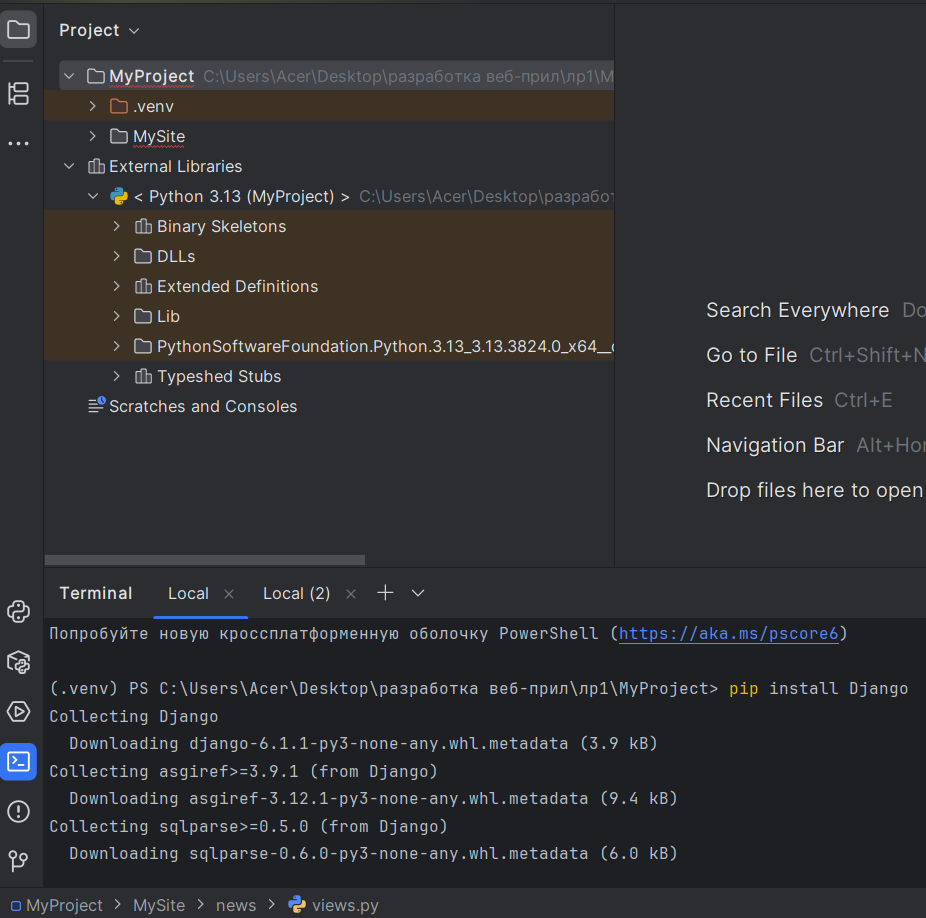
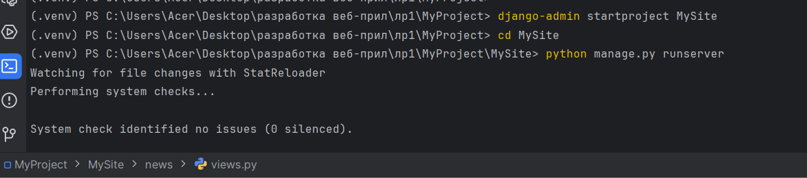

# Лабораторная работа №1

**Тема:** Создание виртуального окружения. Контроллеры и маршруты  
**Дисциплина:** Разработка web-приложений

**Выполнила:**  
Студент группы ПИЖ-б-о-25-1  
Калмазова Серафима Владимировна

**Проверила:**  
ассистент кафедры программной инженерии  
Белик Ангелина Игоревна

*Ставрополь 2026*

---

## Ссылка на репозиторий
[https://github.com/serafima2007k-code/web-app](https://github.com/serafima2007k-code/web-app)

## Цель работы
Настроить виртуальное пространство. Разработать контроллер приложения и организовать маршруты.

---

## Ход выполнения лабораторной работы

### 1. Создание виртуального окружения
Создадим папку `MyProject`, и в этой папке создадим проект с названием нашего проекта, например `MySite`. Установим виртуальное окружение с помощью модуля `venv`, который встроен в Python. Вводим команду `python -m venv venv`, где первое `venv` — модуль, а второе — название папки виртуального окружения, через терминал проекта.

### 2. Активация виртуального окружения
В терминале PyCharm выполняем команду:
```bash
venv\Scripts\activate
(В начале строки терминала появится (venv)).
```

### 3. Установка Django
В терминале (где есть (venv)) вводим команду:

```bash
pip install Django
```



*Рисунок 1 – Установка Django в виртуальном окружении*

### 4. Проверка установленных пакетов
Запустим команду pip list для проверки установленных библиотек.



*Рисунок 2 – Проверка установленных пакетов*

### 5. Создание проекта
В терминале введем команду:

```bash
django-admin startproject MySite
```
После этого появляется папка MySite.

### 6. Переход в папку проекта
Выполняем команду:

```bash
cd MySite
``` 
### 7. Запуск сервера
Запускаем сервер разработки:

```bash
python manage.py runserver
```
Сервер запущен на http://127.0.0.1:8000/. При переходе по адресу отображается стартовая страница Django.

https://./images/fig3.png

### 8. Создание приложения
В терминале (всё ещё в папке MySite) напишем:

```bash
python manage.py startapp news
```
https://./images/fig4.png

### 9. Регистрация приложения
Чтобы Django корректно работало, приложение необходимо зарегистрировать в конфигурации проекта в файле settings.py.

Открываем файл MySite/settings.py.

Находим список INSTALLED_APPS.

Добавляем строчку 'news.apps.NewsConfig'.

https://./images/fig5.png

### 10. Создание контроллера
Открываем файл news/views.py.

Пишем код:

```python
from django.http import HttpResponse

def index(request):
    return HttpResponse("Hello world")
```
Контроллер index создан.

https://./images/fig6.png

### 11. Настройка маршрутов (главный файл)
Открываем файл MySite/urls.py.

Пишем код:

```python
from django.contrib import admin
from django.urls import path, include

urlpatterns = [
    path('admin/', admin.site.urls),
    path('news/', include('news.urls')),
]
```
Главный маршрут настроен.

https://./images/fig7.png

### 12. Настройка маршрутов (файл приложения)
В папке news создаем файл urls.py.

Пишем код:

```python
from django.urls import path
from . import views

urlpatterns = [
    path('', views.index, name='index'),
]
```
Маршруты приложения настроены.

https://./images/fig8.png

### 13. Проверка работы
Запускаем сервер: python manage.py runserver.

Открываем браузер и переходим по адресу: http://127.0.0.1:8000/news/.
Видим текст "Hello world".

https://./images/fig9.png

### 14. Создание второй страницы
В news/views.py добавляем функцию:

```python
def test(request):
    return HttpResponse("Тестовая страница")
https://./images/fig10.png
```

В news/urls.py добавляем маршрут:

```python
path('test/', views.test, name='test'),
https://./images/fig11.png
```

Переходим по адресу: http://127.0.0.1:8000/news/test/. Видим текст "Тестовая страница".

https://./images/fig12.png

## Вывод
Настроила виртуальное пространство; разработала контроллеры приложения и организовала маршруты.
