# Лабораторная работа №2

**Тема:** Модели. CRUD.  
**Дисциплина:** Разработка web-приложений

**Выполнила:**  
Студент группы ПИЖ-6-о-25-1  
Калмазова Серафима Владимировна

**Проверила:**  
ассистент кафедры программной инженерии  
Белик Ангелина Игоревна

*Ставрополь 2026*

---

## Ссылка на репозиторий
[https://github.com/serafima2007k-code/web-app.git](https://github.com/serafima2007k-code/web-app.git)

## Цель работы
Разработка моделей, получение навыков проведения миграции данных и работы с базой данных.

---

## Ход выполнения лабораторной работы

### 1. Подключение базы данных в SQLiteStudio
Открываем папку `C:\SQLiteStudio`, запускаем файл `SQLiteStudio.exe`. Подключаем нашу базу данных `db.sqlite3`.

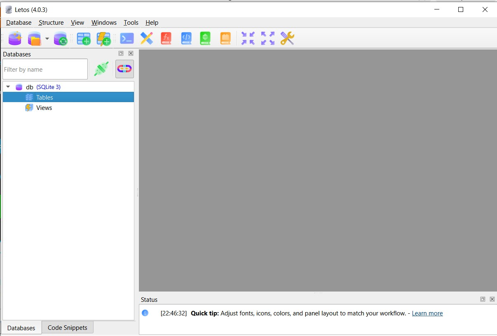

*Рисунок 1 – Подключаем БД*

### 2. Создание модели News
Открываем файл `news/models.py` (или создаём приложение, если его нет). Пишем код:

```python
from django.db import models

class News(models.Model):
    title = models.CharField(max_length=150)
    content = models.TextField(blank=True)
    created_at = models.DateTimeField(auto_now_add=True)
    updated_at = models.DateTimeField(auto_now=True)
    photo = models.ImageField(upload_to='photos/%Y/%m/%d')
    is_published = models.BooleanField(default=True)
```
    # Create your models here.

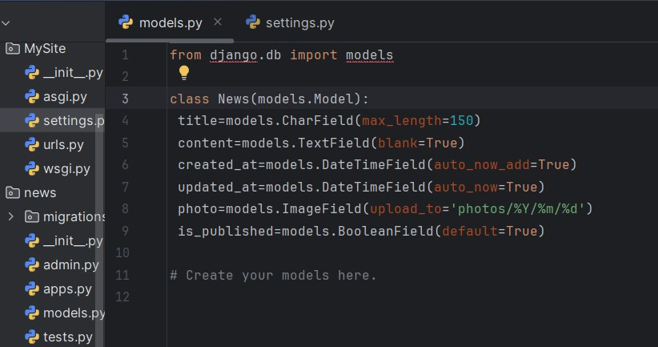

*Рисунок 2 – Создаем модель*

### 3. Создание миграций и установка Pillow
После создания модели переходим к созданию файла миграции. В терминале (в папке MySite) выполняем установку библиотеки Pillow и команды миграции:

bash
pip install Pillow
python manage.py makemigrations
python manage.py migrate

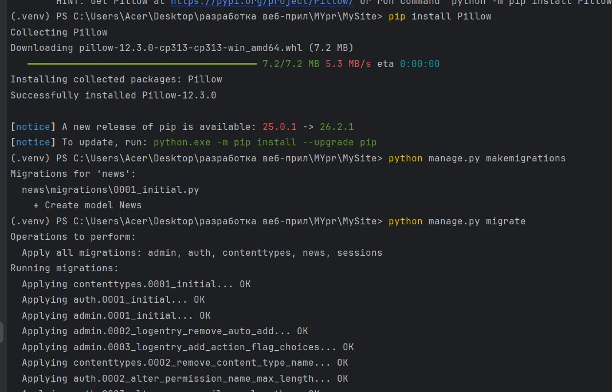

Рисунок 3 – Создание миграции

В результате создан файл 0001_initial.py.

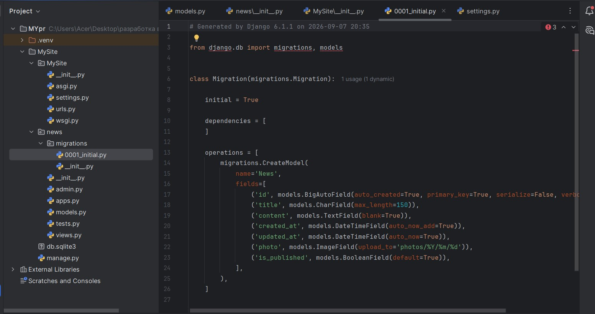

Рисунок 4 – Создан файл 0001_initial.py

### 4. Просмотр SQL-запроса миграции
В терминале выполняем следующий запрос, чтобы увидеть SQL-код создания таблицы:

```bash
python manage.py sqlmigrate news 0001
```
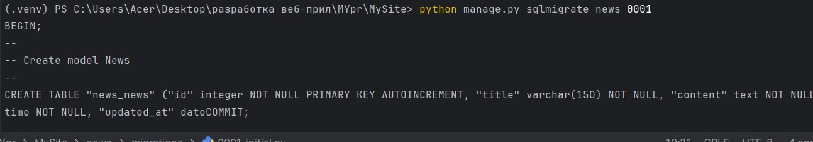

Рисунок 5 – Команда sqlmigrate

### 5. Проверка настроек БД (settings.py)
В пакете конфигурации в файле settings.py можно увидеть, какая БД в настоящий момент подключена (словарь DATABASES). В проекте подключена БД sqlite3.

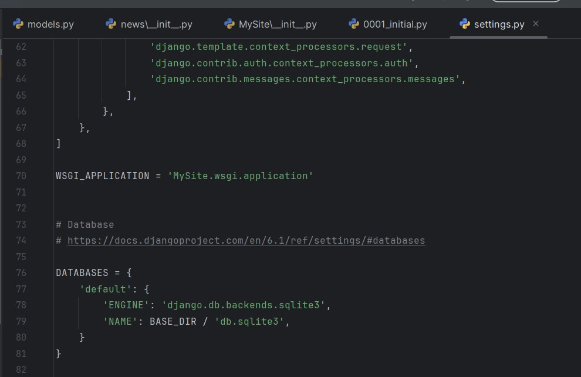

Рисунок 6 – Файл settings (DATABASES)

### 6. Просмотр таблицы в SQLiteStudio
Выбрав в дереве таблиц таблицу news_news, можно просмотреть поля таблицы, соответствующие полям нашей модели, а также SQL-запрос, который был использован для её создания.

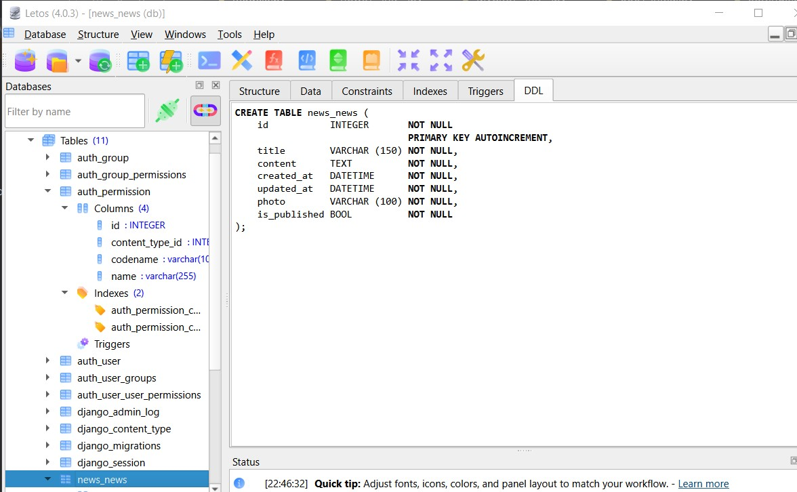

Рисунок 7 – Таблица в SQLiteStudio

### 7. Настройка медиафайлов (settings.py)
В файле MySite/settings.py добавляем в конце:

python
MEDIA_URL = '/media/'
MEDIA_ROOT = BASE_DIR / 'media'

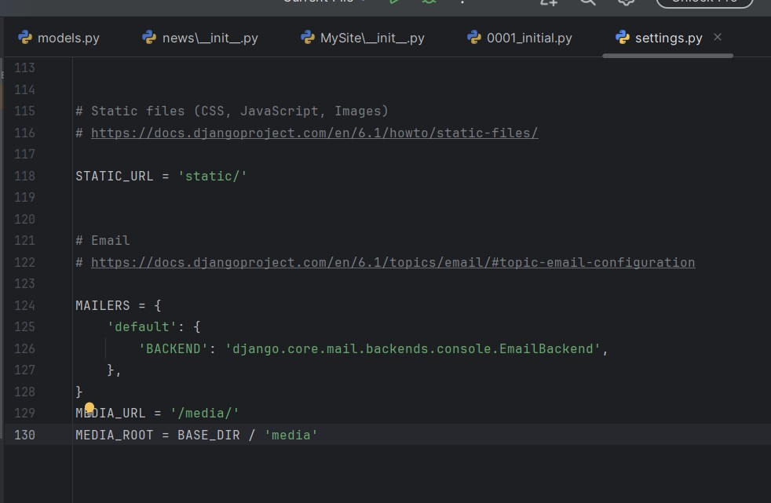

Рисунок 8 – Настройка MEDIA в settings.py

### 8. Настройка маршрутов для медиафайлов (urls.py)
Исходя из константы DEBUG, мы обращаемся к модулю settings, чтобы указать путь для загрузки медиа в отладочном режиме через условие. Открываем MySite/urls.py:

python
from django.conf import settings
from django.conf.urls.static import static

# ... urlpatterns ...

if settings.DEBUG:
    urlpatterns += static(settings.MEDIA_URL, document_root=settings.MEDIA_ROOT)
    
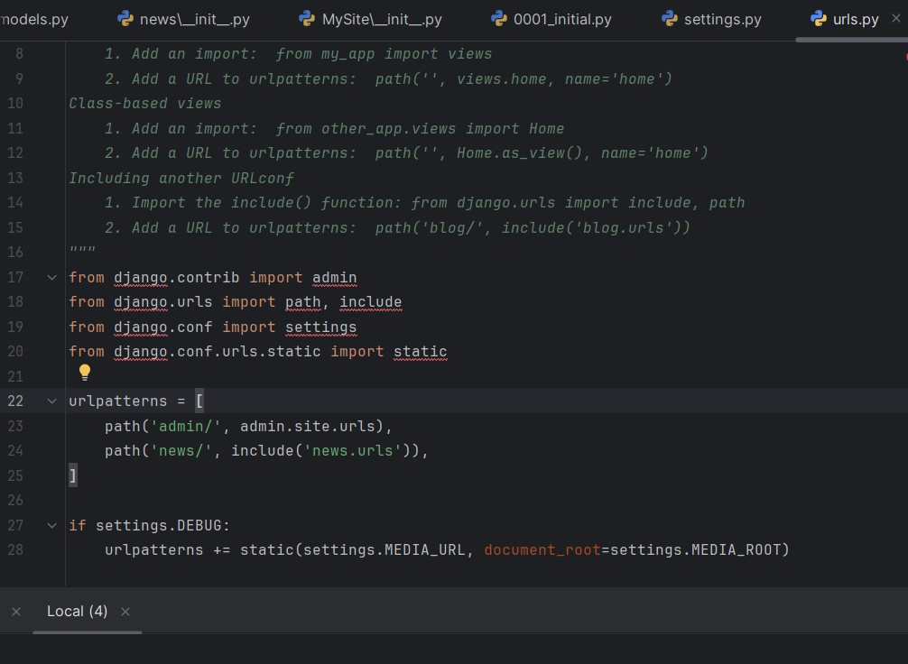

Рисунок 9 – Настройка urls.py

### 9. Работа с ORM через консоль Django
Запускаем консоль:

```bash
python manage.py shell
```
Импортируем модель: from news.models import News

Создание записей (Create):

Способ 1 – конструктор + save():

python
news1 = News(title='Новость 1', content='Контент новости 1')
news1.save()
Способ 2 – без параметров, затем заполнение:

python
news2 = News()
news2.title = 'Новость 2'
news2.content = 'Контент новости 2'
news2.save()
Способ 3 – create():

python
news3 = News.objects.create(title='Новость 3', content='Контент новости 3', is_published=False)

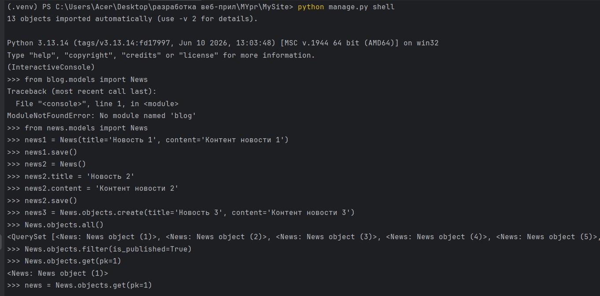

Рисунок 10 – Создание записей

Просмотр выполненных SQL-запросов:

python
from django.db import connection
connection.queries

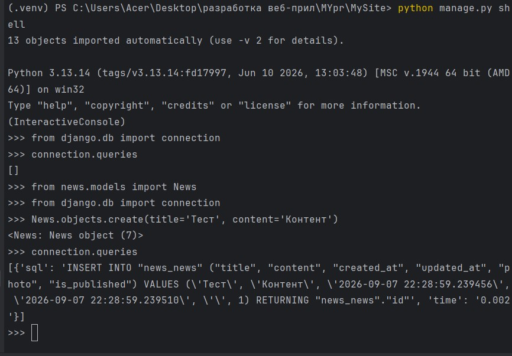

Рисунок 11 – Создание записей (продолжение)

Чтение, обновление и удаление (Read, Update, Delete):

python
# Чтение (Read)
News.objects.all()
News.objects.filter(is_published=True)
News.objects.get(pk=1)

# Обновление (Update)
news = News.objects.get(pk=1)
news.title = 'Обновлённая новость'
news.save()

# Удаление (Delete)
news = News.objects.get(pk=3)
news.delete()

# Исключение (exclude)
News.objects.exclude(title='Новость 4')

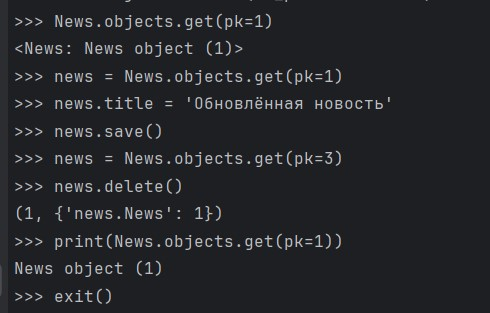

Рисунок 12 – Методы чтения, обновления и удаления

### 10. Просмотр обновленной таблицы
Обновляем таблицу в SQLiteStudio и видим изменения.

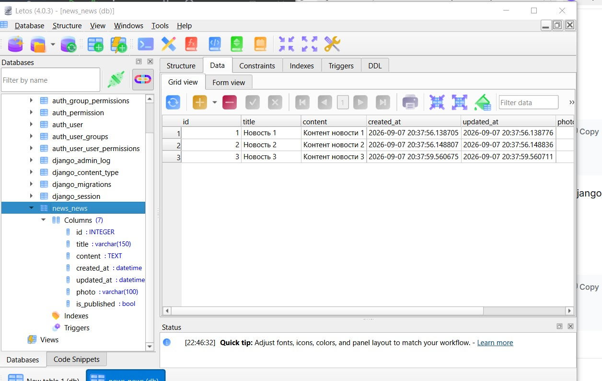

Рисунок 13 – Таблица обновленная

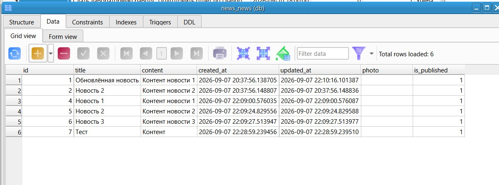

Рисунок 14 – Итоговая таблица

## Индивидуальное задание (Вариант 4. Задачи To-Do)
** Модель: Task (поля: title, description, deadline, is_completed, priority).**
**Дополнительно: добавить поле category (строка, максимум 50 символов).**
**Задача: вывести все невыполненные задачи, отсортированные по приоритету.**

**1. Создание приложения tasks**
В терминале (в папке MySite) выполняем:

```bash
python manage.py startapp tasks
```
**2. Регистрация приложения в settings.py**
Открываем файл MySite/settings.py, находим INSTALLED_APPS и добавляем в конец:

```python
'tasks.apps.TasksConfig',
```
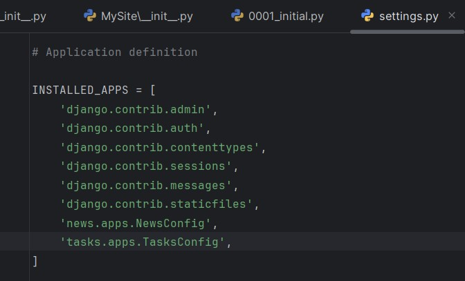

Рисунок 15 – Регистрация приложения в settings.py

**3. Создание модели Task в tasks/models.py**
```python
from django.db import models

class Task(models.Model):
    title = models.CharField(max_length=200)
    description = models.TextField(blank=True)
    deadline = models.DateTimeField()
    is_completed = models.BooleanField(default=False)
    priority = models.IntegerField()
    category = models.CharField(max_length=50)

    def __str__(self):
        return self.title
```
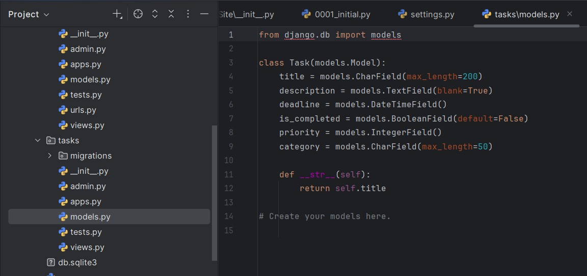

Рисунок 16 – Создание модели Task в tasks/models.py

**4. Создание и применение миграций**
```bash
python manage.py makemigrations
python manage.py migrate
```
**5. Работа с моделью через консоль Django**
Запускаем консоль (python manage.py shell), импортируем модель (from tasks.models import Task) и создаем несколько задач:

```python
Task.objects.create(title='Сдать лабораторную работу', description='Подготовить отчёт по Django', deadline='2026-09-10 18:00:00', is_completed=False, priority=1, category='Учёба')
Task.objects.create(title='Купить продукты', description='Молоко, хлеб, яйца', deadline='2026-09-08 20:00:00', is_completed=True, priority=3, category='Доставка')
Task.objects.create(title='Почистить компьютер', description='Удалить пыль, проверить диски', deadline='2026-09-15 12:00:00', is_completed=False, priority=5, category='Техника')
Task.objects.create(title='Подготовить презентацию', description='Слайды для проекта', deadline='2026-09-09 10:00:00', is_completed=False, priority=2, category='Работа')
```
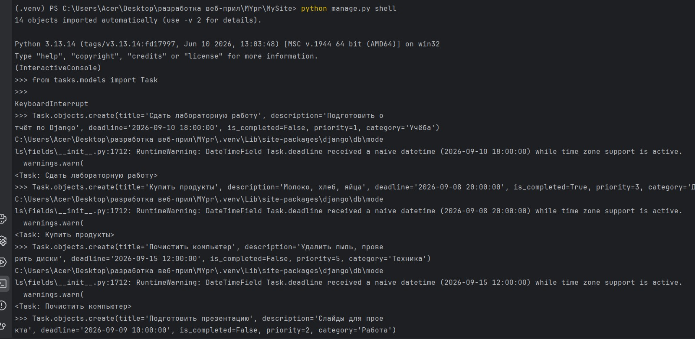

Рисунок 17 – Работа с моделью через консоль Django

**6. Вывод всех невыполненных задач, отсортированных по приоритету**
```python
incomplete_tasks = Task.objects.filter(is_completed=False).order_by('priority')
for task in incomplete_tasks:
    print(f'{task.title} (приоритет: {task.priority}, категория: {task.category})')
```
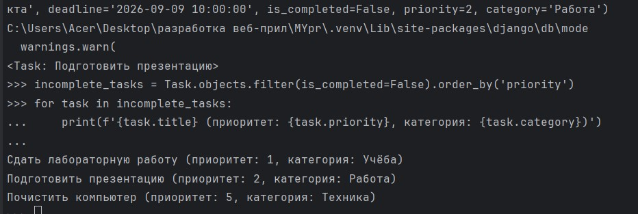

Рисунок 18 – Вывод всех невыполненных задач

**7. Просмотр таблицы tasks_task в SQLiteStudio**
Обновляем базу данных в SQLiteStudio и проверяем таблицу tasks_task.

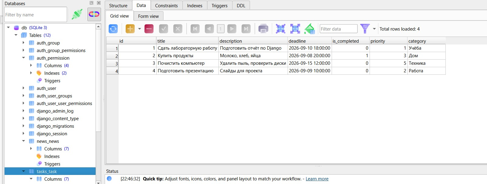

Рисунок 19 – Таблица tasks_task

## Контрольные вопросы
**1. Что такое модель в Django и для чего она используется?**
Модель – это класс Python, наследующий от django.db.models.Model. Она описывает структуру таблицы в базе данных и предоставляет интерфейс для работы с данными (ORM). Каждое поле модели соответствует столбцу таблицы.

**2. Какие типы полей вы знаете? Приведите примеры.**

CharField – строка (например, title)

TextField – большой текст (content)

DateTimeField – дата и время (created_at)

BooleanField – логическое (is_published)

IntegerField – целое число (views_count)

ImageField – изображение (photo)

**3. Чем отличаются параметры blank=True и null=True?**

blank=True – поле может быть пустым в формах (валидация на уровне форм).

null=True – поле может хранить NULL в базе данных (на уровне БД).

**4. Что такое миграции и зачем они нужны? Опишите основные команды.**
Миграции – это способ отслеживания изменений в структуре БД и их применения.

makemigrations – создаёт файлы миграций

migrate – применяет миграции к БД

sqlmigrate – показывает SQL-запрос

**5. Как создать суперпользователя для доступа к административной панели Django?**
Выполнить команду python manage.py createsuperuser и ввести логин, email и пароль.

**6. Что такое ORM? Перечислите основные методы для выполнения операций CRUD.**
ORM (Object-Relational Mapping) – технология, позволяющая работать с БД через объекты Python.

Create: create() или конструктор + save()

Read: all(), filter(), get(), exclude()

Update: изменение атрибутов + save()

Delete: delete()

**7. В чем разница между методами filter() и get()?**

filter() возвращает QuerySet (набор записей), может вернуть пустой набор или несколько записей.

get() возвращает один объект, если найдено ровно одно совпадение, иначе выбрасывает исключение.

**8. Как настроить загрузку изображений (медиафайлов) в проекте Django?**
В settings.py задать MEDIA_ROOT (путь для хранения) и MEDIA_URL (URL-префикс). В urls.py добавить маршрут через static() в режиме отладки.

**9. Для чего нужен метод __str__ в модели?**
Он определяет строковое представление объекта, которое используется в админке, в консоли и при выводе объектов.

**10. Что произойдёт, если выполнить makemigrations, но не выполнить migrate?**
Будут созданы файлы миграций, но изменения в структуре БД не применятся. Таблицы не обновятся, новые поля не появятся.

## Вывод
Научилась разрабатывать модели и проводить миграцию данных, работать с базой данных.
