# Лабораторная работа №3

**Тема:** Шаблоны. Админка Django  
**Дисциплина:** Разработка web-приложений

**Выполнила:**  
Студент группы ПИЖ-6-о-25-1  
Калмазова Серафима Владимировна

**Проверила:**  
ассистент кафедры программной инженерии  
Белик Ангелина Игоревна

*Ставрополь 2026*

---

## Ссылка на Git-репозиторий
[https://github.com/serafima2007k-code/web-app.git](https://github.com/serafima2007k-code/web-app.git)

## Цель работы
Научиться выводить данные из модели в браузер с помощью шаблонов, освоить работу с админкой Django, настроить отображение модели в админке.

---

## Ход выполнения лабораторной работы

### 1. Вывод данных из модели в браузер (без шаблона)

Импортируем модель в `views.py` и формируем ответ в контроллере:

```python
from django.shortcuts import render
from django.http import HttpResponse
from .models import News

def index(request):
    news = News.objects.all()
    res = '<h1>Список новостей</h1>'
    for item in news:
        res += f'<div>\n<p>{item.title}</p>\n<p>{item.content}</p>\n</div>\n<hr>'
    return HttpResponse(res)
```
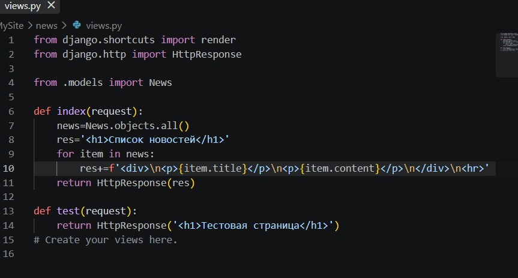

Рисунок 1 – Код функции index

Запускаем сервер (python manage.py runserver), открываем http://127.0.0.1:8000/news/ и обновляем страницу.

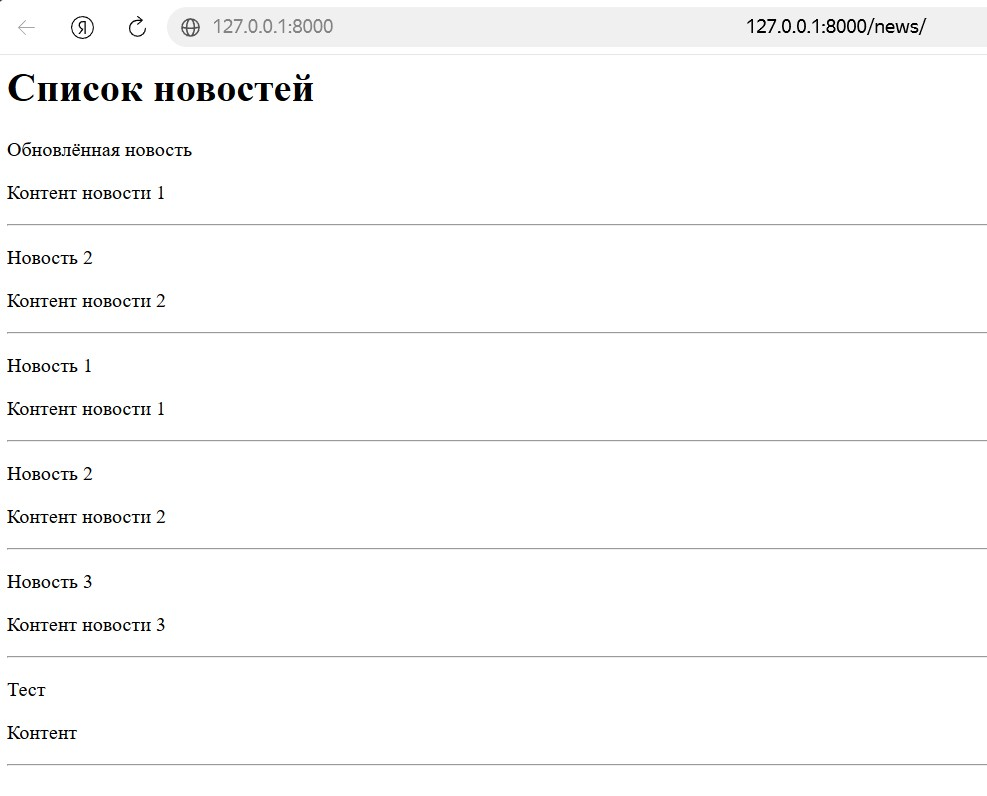

Рисунок 2 – Страница со списком новостей

### 2. Работа с шаблонами
Создаем папку templates, внутри нее папку news. В папке news/templates/news/ создаем файл index.html.

```html
<!DOCTYPE html>
<html lang="en">
<head>
    <meta charset="UTF-8">
    <title>Список новостей</title>
</head>
<body>
</body>
</html>
```
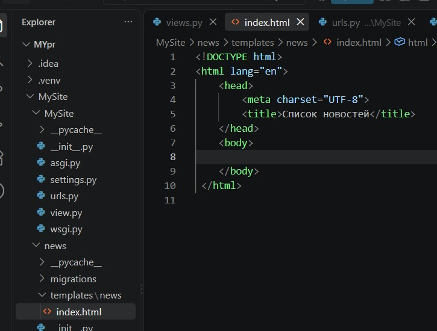

Рисунок 3 – Содержимое index.html

В файле news/views.py добавляем импорт функции render:

```python
from django.shortcuts import render
```
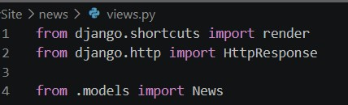

Рисунок 4 – Импорт render

Используем render в контроллере:

```python
def index(request):
    news = News.objects.all()
    return render(request, 'news/index.html', {'news': news, 'title': 'Список новостей'})
```
Выводим данные в шаблоне внутри <body>:

```html
<h1>{{ title }}</h1>
{{ news }}
```
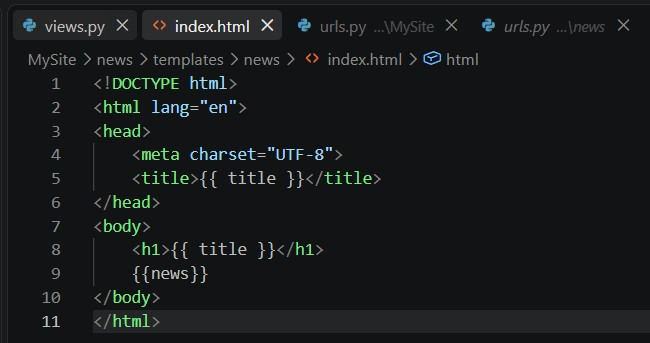

Рисунок 5 – Вывод {{ title }} и {{ news }}

На странице отобразится нечитабельный список объектов <QuerySet [...]>.

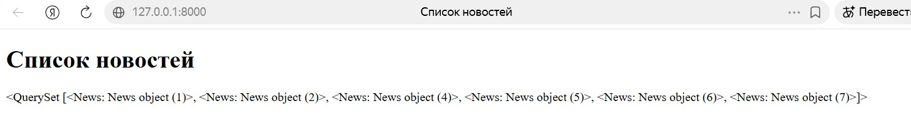

Рисунок 6 – Заголовок и необработанный список объектов

Используем тег for для красивого вывода:

```html
<h1>{{ title }}</h1>

    <div>
        <p>{{ item.title }}</p>
        <p>{{ item.content }}</p>
    </div>
    <hr>

```
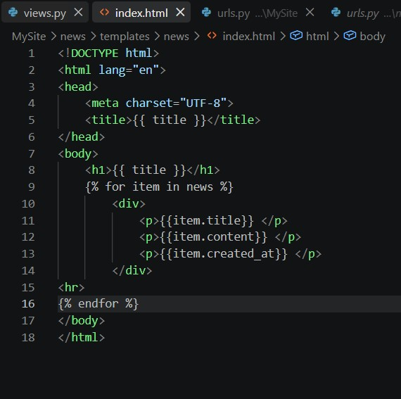

Рисунок 7 – Использование тега for

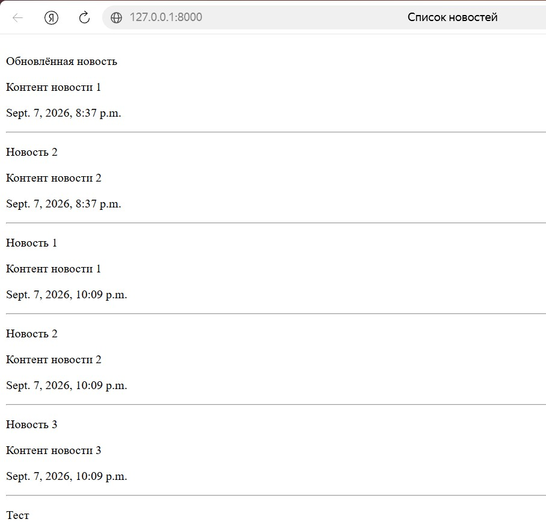

Рисунок 8 – Обновлённая страница

### 3. Изменение языка на русский и использование фильтров
В файле MySite/settings.py меняем LANGUAGE_CODE:

```python
LANGUAGE_CODE = 'ru'
```
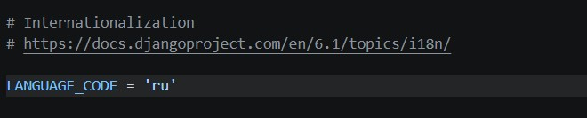

Рисунок 9 – Файл settings.py

Обновляем страницу и видим русский формат дат.

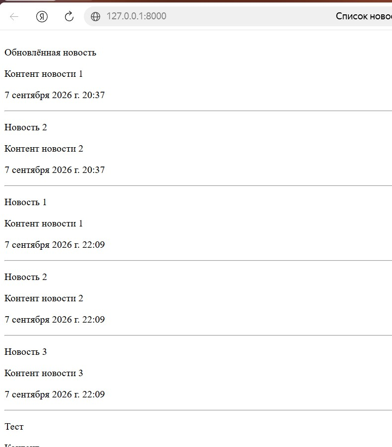

Рисунок 10 – Страница с русскими датами

Используем фильтр date в шаблоне index.html:

```html
<p>{{ item.created_at|date:"Y-m-d H:i:s" }}</p>
```
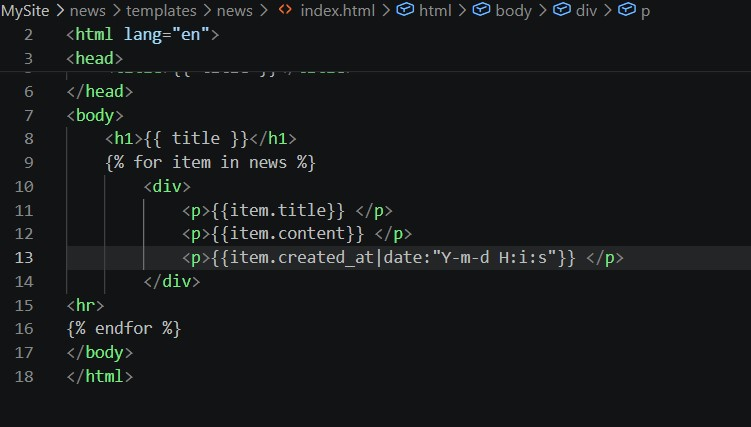

Рисунок 11 – Файл index.html

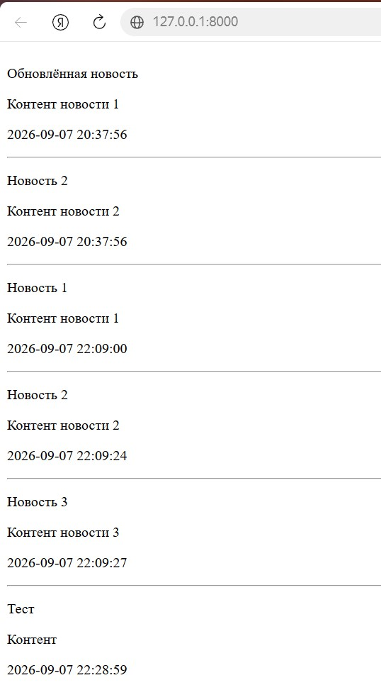

Рисунок 12 – Страница с датой в формате ISO

Создаем переменную context в контроллере:

```python
def index(request):
    news = News.objects.all()
    context = {
        'news': news,
        'title': 'Список новостей',
    }
    return render(request, 'news/index.html', context)
```
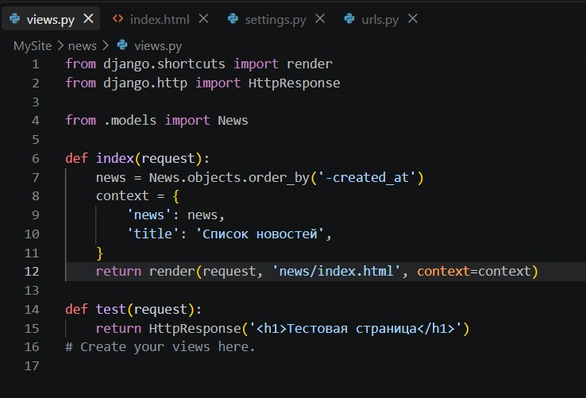

Рисунок 13 – Переменная context в контроллере

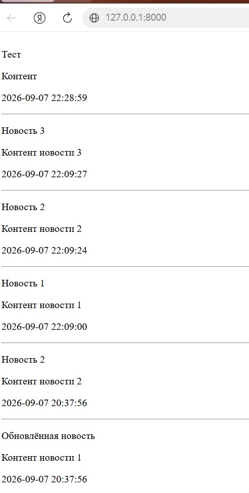

Рисунок 14 – Обновленная страница

Для сортировки в views.py заменяем all() на order_by('-created_at'):

```python
news = News.objects.order_by('-created_at')
```
### 4. Админка Django
В терминале создаем суперпользователя:

```bash
python manage.py createsuperuser
```
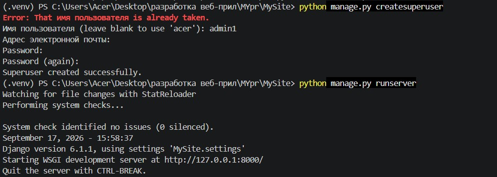

Рисунок 15 – Успешное создание суперпользователя

Заходим в админку по адресу http://127.0.0.1:8000/admin/.

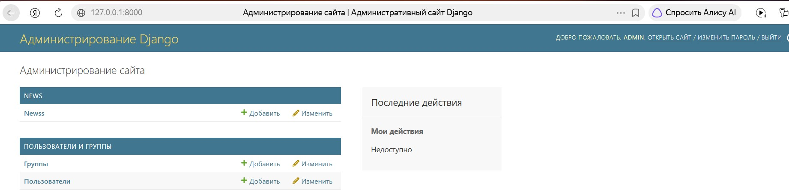

Рисунок 16 – Главная страница админки

Регистрируем модель News в news/admin.py:

```python
from django.contrib import admin
from .models import News

admin.site.register(News)
```
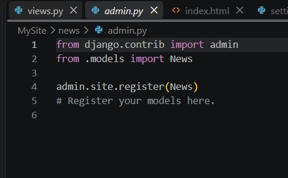

Рисунок 17 – Файл admin.py

В админке появился раздел NEWS, где можно добавлять и редактировать новости.

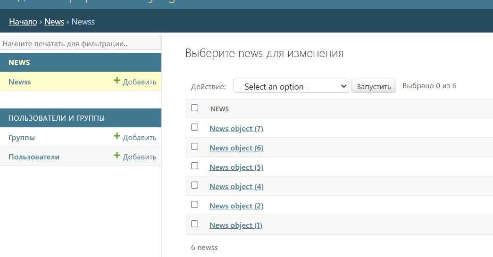

Рисунок 18 – Формы добавления пользователя и группы

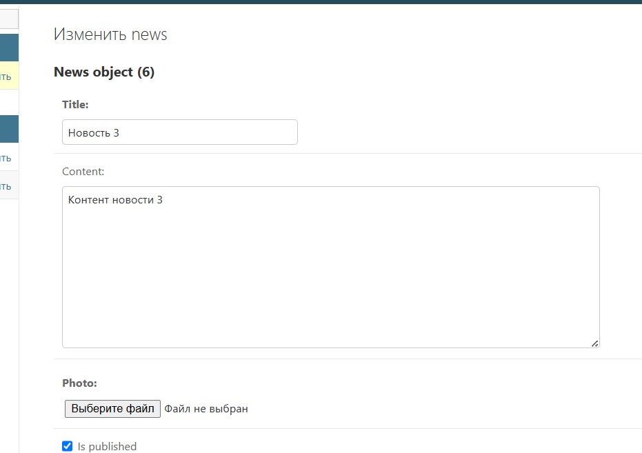

Рисунок 19 – Страница редактирования новости

### 5. Настройка модели и админки
В news/models.py добавляем подкласс Meta:

```python
class Meta:
    verbose_name = 'Новость'
```
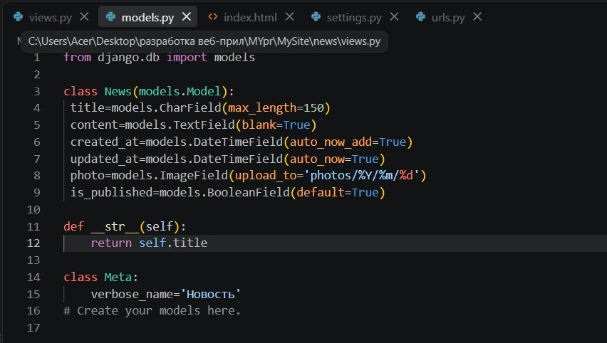

Рисунок 20 – Файл models.py

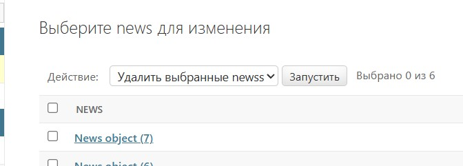

Рисунок 21 – Результат страницы (удалить)

Добавляем verbose_name_plural:

```python
verbose_name_plural = 'Новости'
```
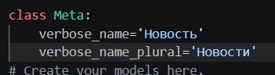

Рисунок 22 – Атрибут

Добавляем сортировку через ordering:

```python
ordering = ['-created_at']
```
Возвращаем в views.py News.objects.all().

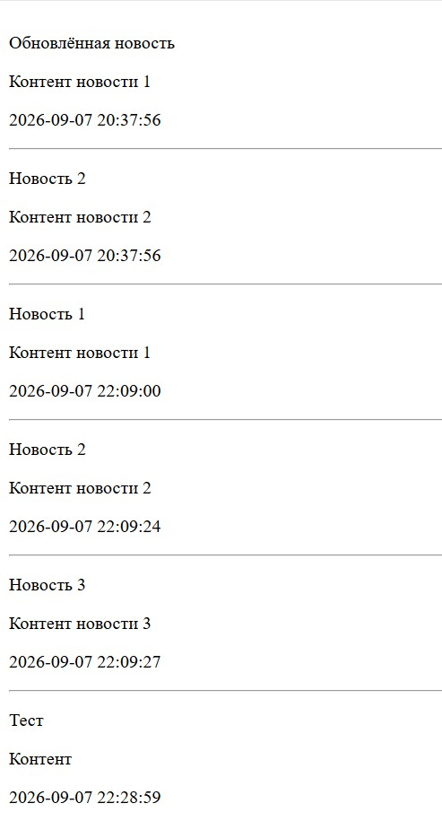

Рисунок 23 – Список новостей с новой сортировкой

Меняем название приложения в news/apps.py:

```python
verbose_name = 'Новости'
```
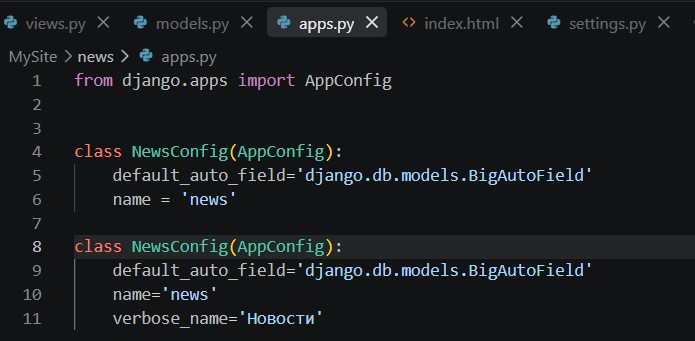

Рисунок 24 – Файл apps.py

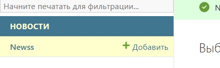

Рисунок 25 – Раздел «НОВОСТИ»

Настраиваем list_display в news/admin.py:

```python
class NewsAdmin(admin.ModelAdmin):
    list_display = ('id', 'title', 'created_at', 'updated_at', 'is_published')

admin.site.register(News, NewsAdmin)
```
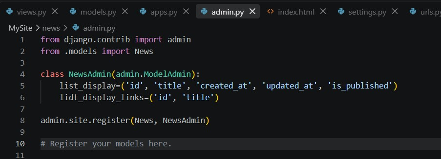

Рисунок 26 – Список с новыми колонками

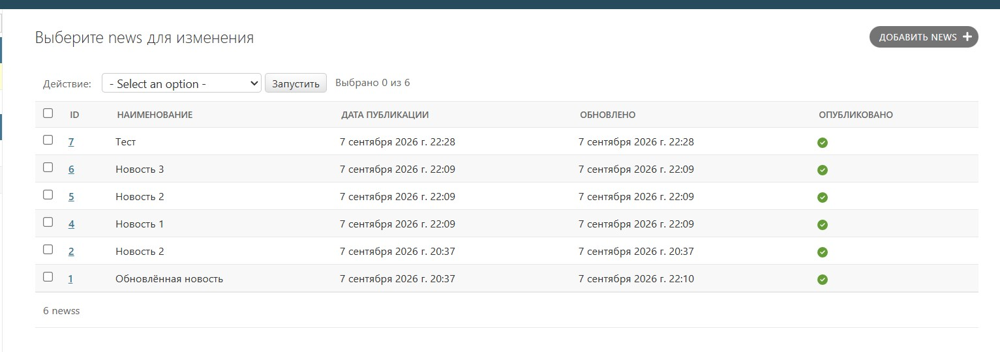

Рисунок 27 – Обновленная страница

Добавляем verbose_name к полям в models.py:

```python
title = models.CharField(max_length=150, verbose_name='Наименование')
content = models.TextField(blank=True, verbose_name='Контент')
created_at = models.DateTimeField(auto_now_add=True, verbose_name='Дата публикации')
updated_at = models.DateTimeField(auto_now=True, verbose_name='Обновлено')
photo = models.ImageField(upload_to='photos/%Y/%m/%d', verbose_name='Фото')
is_published = models.BooleanField(default=True, verbose_name='Опубликовано')
```
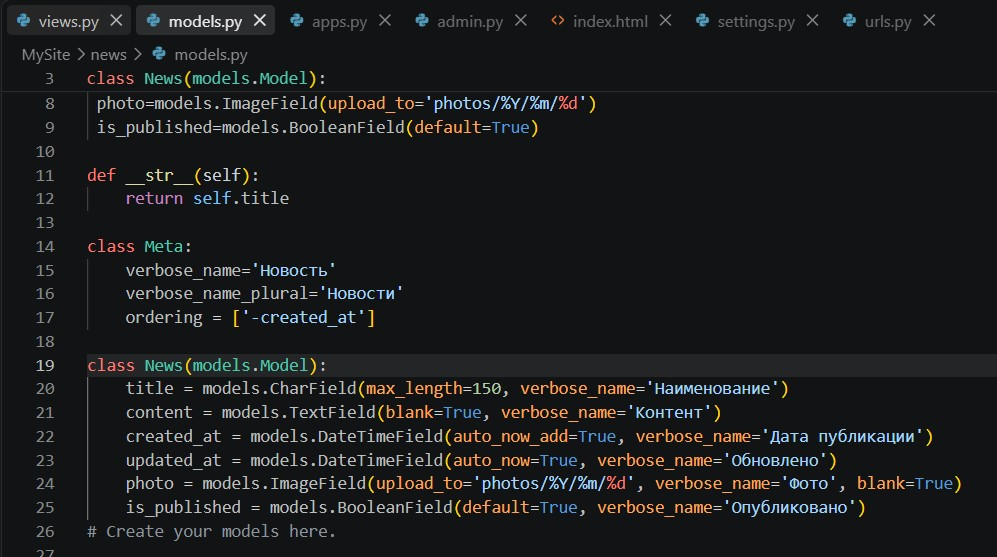

Рисунок 28 – Русские заголовки колонок

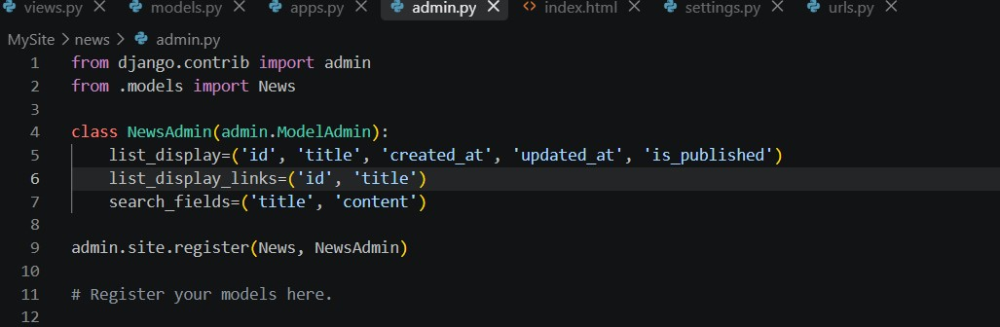

Рисунок 29 – Обновленная страница

Добавляем list_display_links в NewsAdmin:

```python
list_display_links = ('id', 'title')
```
Добавляем search_fields:

```python
search_fields = ('title', 'content')
```


Рисунок 30 – Ссылки в списке и поле поиска

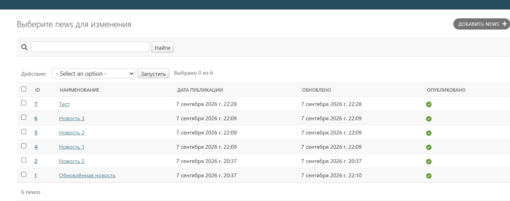
Рисунок 31 – Поле поиска

### 6. Работа с медиафайлами и валидация
Добавляем новость без фото и нажимаем «Сохранить». Появляется ошибка «Обязательное поле».

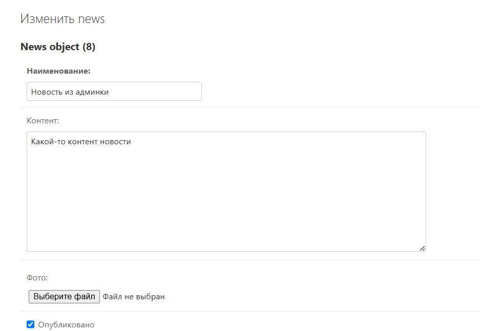

Рисунок 32 – Форма

Добавляем фото и сохраняем новость.

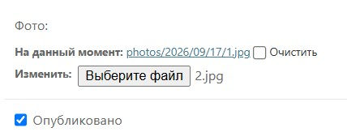

Рисунок 33 – Успешное сохранение

В корне проекта появляется папка media.

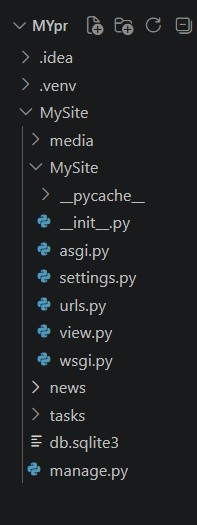

Рисунок 34 – Папка media

Чтобы сделать поле фото необязательным, в news/models.py добавляем blank=True:

```python
photo = models.ImageField(upload_to='photos/%Y/%m/%d', verbose_name='Фото', blank=True)
```
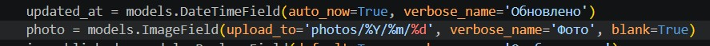

Рисунок 35 – Файл models.py

Выполняем миграции:

```bash
python manage.py makemigrations
python manage.py migrate
```
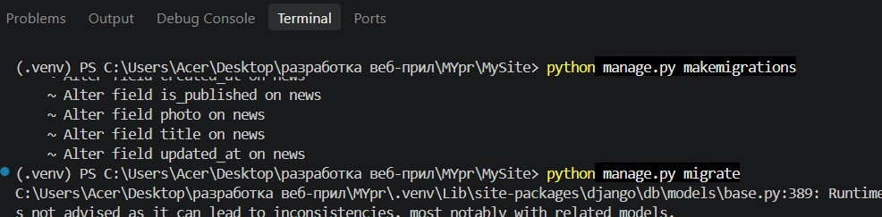

Рисунок 36 – Команды и результаты

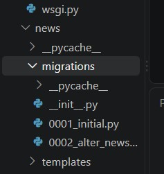

Рисунок 37 – Структура миграций

Теперь запись без фото успешно сохраняется.

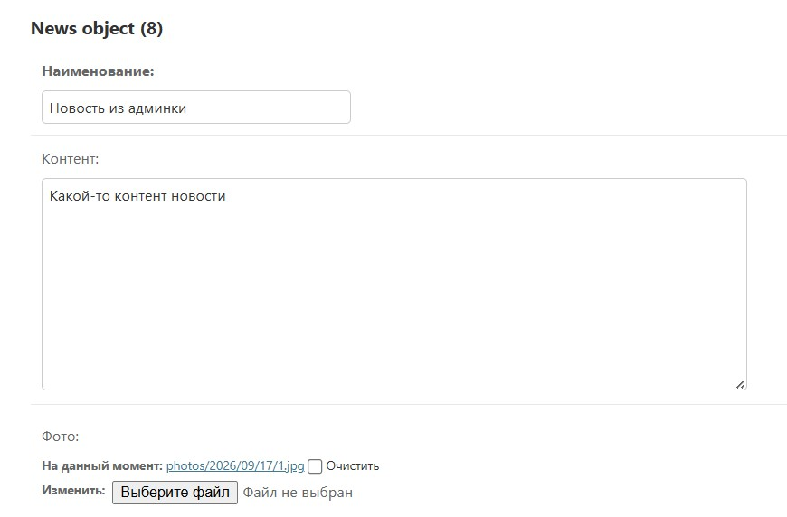

Рисунок 38 – Админка с сообщением об успехе

## Вывод
Научилась выводить данные из модели в браузер с помощью шаблонов, освоила работу с админкой Django, настроила отображение модели в админке.
