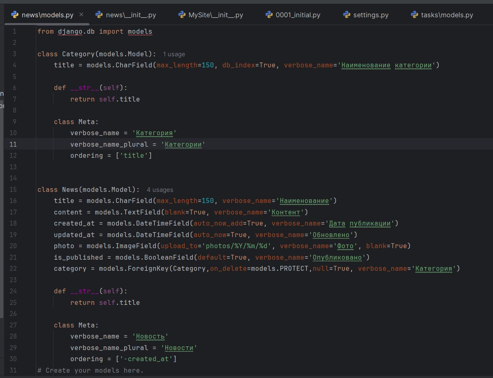

# Лабораторная работа №4

**Тема:** Связи моделей. Внешний вид шаблона  
**Дисциплина:** Разработка web-приложений

**Выполнила:**  
Студент группы ПИЖ-6-о-25-1  
Калмазова Серафима Владимировна

**Проверила:**  
ассистент кафедры программной инженерии  
Белик Ангелина Игоревна

*Ставрополь 2026*

---

## Ссылка на Git-репозиторий
[https://github.com/serafima2007k-code/web-app.git](https://github.com/serafima2007k-code/web-app.git)

## Цель работы
Освоить создание и настройку связей между моделями Django (ForeignKey, ManyToManyField, OneToOneField), изучить параметры связей (on_delete, related_name, null, blank, default), научиться применять миграции при добавлении связей к существующим моделям, а также настраивать отображение связанных данных в административной панели Django.

---

## Теоретическое обоснование

В Django есть три типа связей между моделями:

| Тип связи | Класс | Пример |
|---|---|---|
| Многие-к-одному | ForeignKey | Одна категория – много новостей |
| Многие-ко-многим | ManyToManyField | Один пост – много тегов, один тег – много постов |
| Один-к-одному | OneToOneField | Один пользователь – один профиль |

**Параметры связей:**
- `on_delete` – что делать при удалении связанного объекта (CASCADE, PROTECT, RESTRICT, SET_NULL).
- `related_name` – имя для обратного доступа (например, `category.news_set` или `category.news`).
- `null=True` – разрешить NULL в БД.
- `blank=True` – разрешить пустое значение в формах.
- `default` – значение по умолчанию.

---

## Ход выполнения лабораторной работы

### 1. Создание модели Category
Открываем `news/models.py`. Добавляем перед классом `News` модель `Category`.

**Пояснение:**
- `db_index=True` – создаёт индекс в БД для быстрого поиска по полю.
- `__str__` возвращает название категории (важно для отображения в админке).
- `Meta.ordering` – сортировка категорий по названию.
- `verbose_name` – русское название модели в админке.

### 2. Добавление связи ForeignKey в модель News
В том же файле `news/models.py` в класс `News` добавляем поле `category`.

**Пояснение:**
- `ForeignKey(Category, ...)` – связь «многие-к-одному»: одна категория может быть у многих новостей.
- `on_delete=models.PROTECT` – запрещает удаление категории, если в ней есть новости.
- `null=True` – разрешает пустое значение в БД (нужно, так как в таблице уже есть записи).
- `verbose_name='Категория'` – русское название поля в админке.



*Рисунок 1 – Модели Category и News в файле news/models.py*

### 3. Миграции
Создаем миграции и применяем их к базе данных:

```bash
python manage.py makemigrations
python manage.py migrate
```
После успешного применения миграции в БД появятся:

Таблица news_category (категории).

Новое поле category_id в таблице news_news (внешний ключ).


Рисунок 2 – Создание и применение миграций для моделей Category и News


Рисунок 3 – Структура базы данных после миграций (таблицы news_category и news_news)


Рисунок 4 – Ограничения таблицы news_news (внешний ключ на news_category)


Рисунок 5 – SQL-запрос создания таблицы news_news

### 4. Регистрация модели Category в админке
Открываем news/admin.py и добавляем настройку для модели Category.


Рисунок 6 – Настройка админ-панели для моделей News и Category

### 5. Проверка в админке
Запускаем сервер:

```bash
python manage.py runserver
```
Открываем http://127.0.0.1:8000/admin/.


Рисунок 7 – Запуск сервера разработки

В разделе «Категории» добавляем несколько категорий (Культура, Наука, Политика, Спорт).


Рисунок 8 – Список категорий в админ-панели

Переходим в «Новости» и открываем любую новость. В поле «Категория» выбираем нужную из списка.


Рисунок 9 – Выпадающий список категорий при редактировании новости

Если поле не заполнено – появится ошибка «Обязательное поле» (валидатор формы). Чтобы её избежать, добавляем blank=True в модель.


Рисунок 10 – Ошибка «Обязательное поле» при невыбранной категории


Рисунок 11 – Список новостей с колонкой «Категория» и панелью фильтров

## Индивидуальные задания (Вариант 9. Новостной сайт)
Требования:

Первичная модель: Category (название, slug, описание).
Вторичная модель: News (заголовок, содержание, фото, дата).
Тип связи: ForeignKey.
on_delete: PROTECT.
Дополнительно: list_display с категорией, list_filter по категории.

**1. Модель Category**
В модель добавлены поля slug и description.


Рисунок 12 – Модель Category для индивидуального задания (с полями slug и description)

**2. Модель News**
related_name='news' – позволяет получить все новости категории: category.news.all().

on_delete=models.PROTECT – запрещает удалять категорию с новостями.


Рисунок 13 – Модель News с настройками связи для варианта 9

**3. Миграции**
Создаем и применяем миграции для новых полей:

```bash
python manage.py makemigrations
python manage.py migrate
```


Рисунок 14 – Миграции для индивидуального задания

**4. Настройка админки (news/admin.py)**
Открыла news/admin.py и привела его к виду:

list_display в NewsAdmin содержит category – это требование варианта.

list_filter = ('is_published', 'category') – панель фильтров справа по категории и статусу.

search_fields = ('title',)

prepopulated_fields – при вводе названия категории поле slug заполнится автоматически.


Рисунок 15 – Настройка админ-панели для индивидуального задания

**5. Запуск и проверка**
Запускаем сервер:

```bash
python manage.py runserver
```
Открываем браузер: http://127.0.0.1:8000/admin/


Рисунок 16 – Запуск сервера

5.1. Создание категорий
В разделе «Категории» → «Добавить» создала категории, указав название, slug (заполнился сам) и описание.

5.2. Привязка новостей к категориям
В разделе «Новости» открыла каждую новость и присвоила им категории.


Рисунок 17 – Список новостей с фильтром по категории

5.3. Проверка list_filter
В списке новостей справа появилась панель «Фильтр» (Опубликовано: Все/Да/Нет; Категория: Все/Культура/Наука/Политика/Спорт). При клике по категории список отфильтровывается.


Рисунок 18 – Отфильтрованный список новостей

5.4. Проверка каскадной операции on_delete=models.PROTECT
В разделе «Категории» попробовала удалить «Культура» (в которой есть новости). Django выдал ошибку удаления защищённых объектов.


Рисунок 19 – Ошибка ProtectedError при попытке удалить категорию с новостями

## Вывод
Освоила создание и настройку связей между моделями Django (ForeignKey, ManyToManyField, OneToOneField), изучила параметры связей (on_delete, related_name, null, blank, default), научилась применять миграции при добавлении связей к существующим моделям, а также настраивала отображение связанных данных в административной панели Django.
