# Лабораторная работа №5

**Тема:** Внешний вид шаблона. Директивы. Теги. Фильтры.  
**Дисциплина:** Разработка web-приложений

**Выполнила:**  
Студент группы ПИЖ-6-о-25-1  
Калмазова Серафима Владимировна

**Проверила:**  
ассистент кафедры программной инженерии  
Белик Ангелина Игоревна

*Ставрополь 2026*

---

## Ссылка на Git-репозиторий
[https://github.com/serafima2007k-code/web-app.git](https://github.com/serafima2007k-code/web-app.git)

## Цель работы
Освоить подключение CSS-фреймворка Bootstrap через CDN, применить готовые компоненты (Navbar, Card) для оформления шаблона Django, изучить встроенные теги и фильтры шаблонного языка Django.

---

## Ход выполнения лабораторной работы

### 1. Вставка и адаптация шаблона в Django
Перешла по ссылке на страницу RTL-шаблона Bootstrap, нашла в правом меню **Starter template** и скопировала его. Открыла файл `news/templates/news/index.html` в PyCharm и вставила скопированный код. 

Затем адаптировала шаблон под проект:
- Язык `ar` заменила на `en`.
- Удалила `dir="rtl"`.
- Убрала все комментарии и арабские надписи.
- В `<title>` поставила переменную `{{ title }}`, которая приходит из контроллера.

**Проверка:** обновила `http://127.0.0.1:8000/news/`. Заголовок вкладки браузера изменился на «Список новостей».

### 2. Добавление Navbar (навигационной панели)
На сайте Bootstrap в разделе Components выбрала **Navbar**. Скопировала шаблон и вставила его в `index.html`.

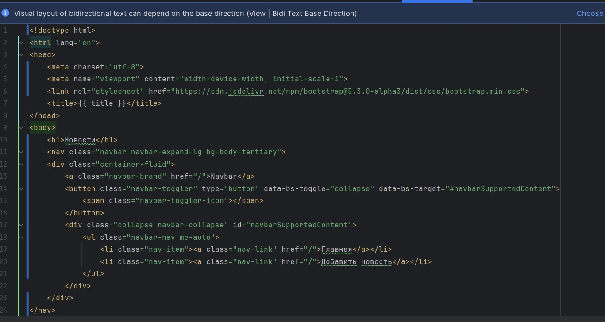

*Рисунок 1 – Итоговый код index.html после добавления Navbar и адаптации шаблона*

**Проверка:** обновила страницу – сверху появилась панель навигации с двумя ссылками.

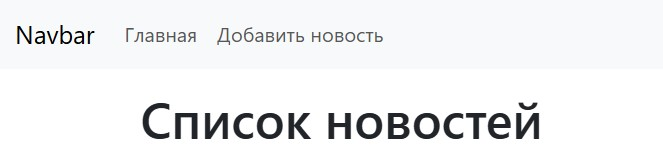

*Рисунок 2 – Навигационная панель с ссылками «Главная» и «Добавить новость»*

### 3. Создание списка новостей в контейнере
Добавила контейнер с классами Bootstrap:
- `container` – центрирует контент с отступами по бокам.
- `mt-3` – верхний отступ (margin-top).
- `row` – строка сетки Bootstrap.

```html
<div class="container mt-3">
    <h1>{{ title }}</h1>
    <div class="row">
        
            <!-- здесь будет карточка новости -->
        
    </div>
</div>
```
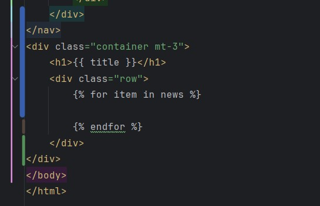

Рисунок 3 – Код контейнера и цикла  для вывода новостей

### 4. Добавление Card (карточки новости)
На сайте Bootstrap в разделе Components выбрала Card. Вставила шаблон карточки внутри цикла .

Заменила статический текст на переменные:

Featured → Категория или {{ item.category }}

Special title treatment → {{ item.title }}

With supporting text below → {{ item.content }}

Go somewhere → Read more...

Добавила футер с датой:

```html
<div class="card-footer text-muted">
    {{ item.created_at|date:"Y-m-d H:i:s" }}
</div>
```
Пояснение: card-footer – нижняя часть карточки, text-muted – приглушённый цвет текста, |date:"Y-m-d H:i:s" – фильтр, форматирует дату в вид 2023-03-17 16:15:28.

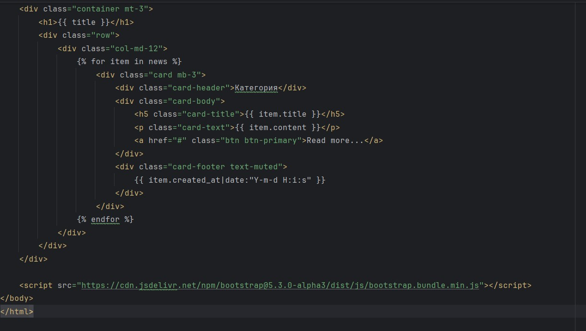

Рисунок 4 – Код карточки новости (Card) с переменными {{ item.title }}, {{ item.content }}

### 5. Заполнение новостей текстом через админку
Открыла сайт https://ru.lipsum.com/ и скопировала «рыбу» текста. В админке (http://127.0.0.1:8000/admin/) перешла в Новости, открыла каждую новость и вставила текст в поле Контент.

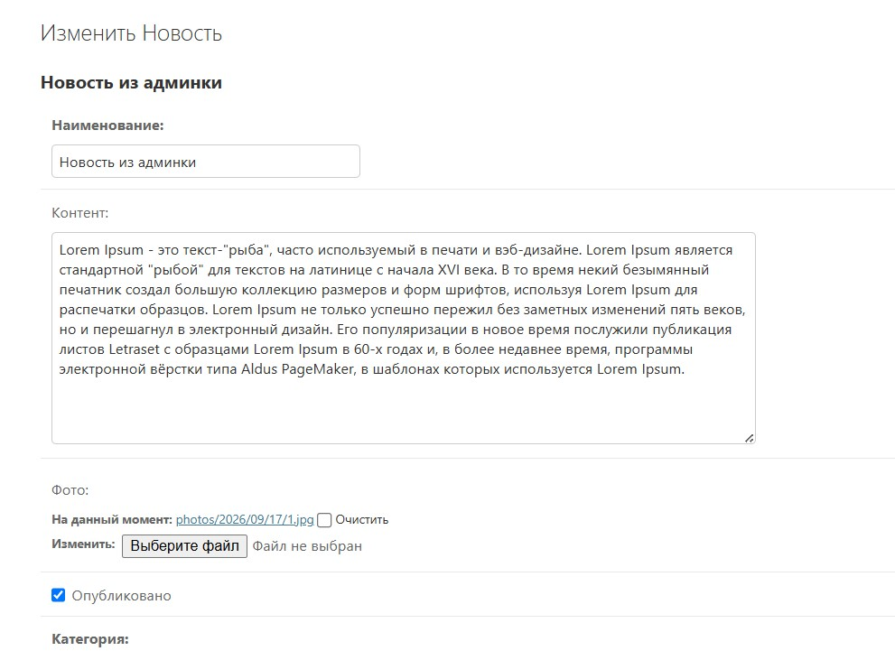

Рисунок 5 – Форма редактирования новости в админке с заполненным текстом

На странице /news/ в каждой карточке появился полный текст новости.

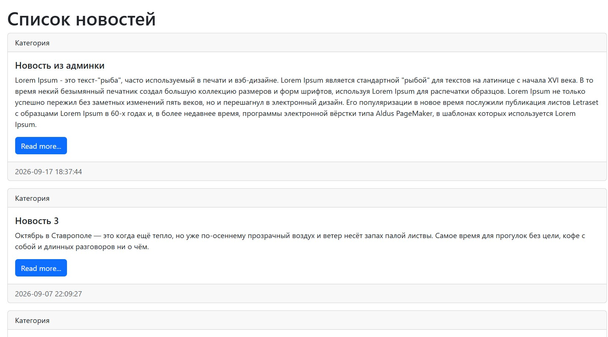

Рисунок 6 – Список новостей с карточками

### 6. Вывод категории в карточке
В шаблоне изменила card-header, заменив статичный текст на переменную категории:

```html
<div class="card-header">Категория: {{ item.category }}</div>
```
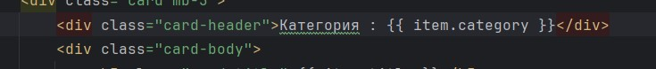

Рисунок 7 – Изменённый card-header с выводом категории {{ item.category }}

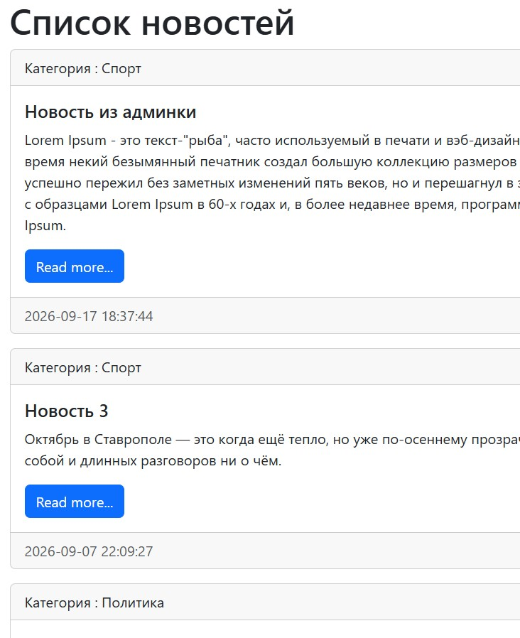

Рисунок 8 – Отображение категории в шапке карточки на странице новостей

### 7. Вызов методов модели из шаблона
В news/models.py добавила метод my_func в модель News:

```python
def my_func(self):
    return 'Последние новости'
```
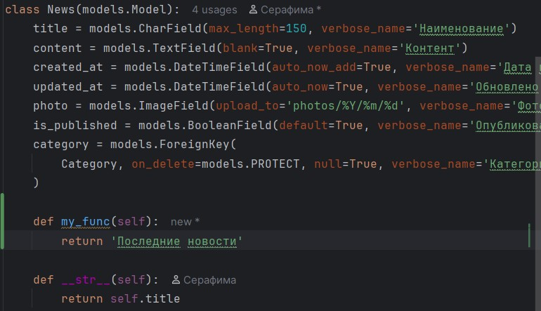

Рисунок 9 – Добавленный метод my_func в модель News

Вызвала метод в шаблоне index.html в card-header:

```html
<div class="card-header">
    {{ item.my_func }}
    Категория: {{ item.category }}
</div>
```
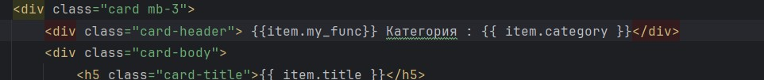

Рисунок 10 – Вызов метода {{ item.my_func }} в шаблоне

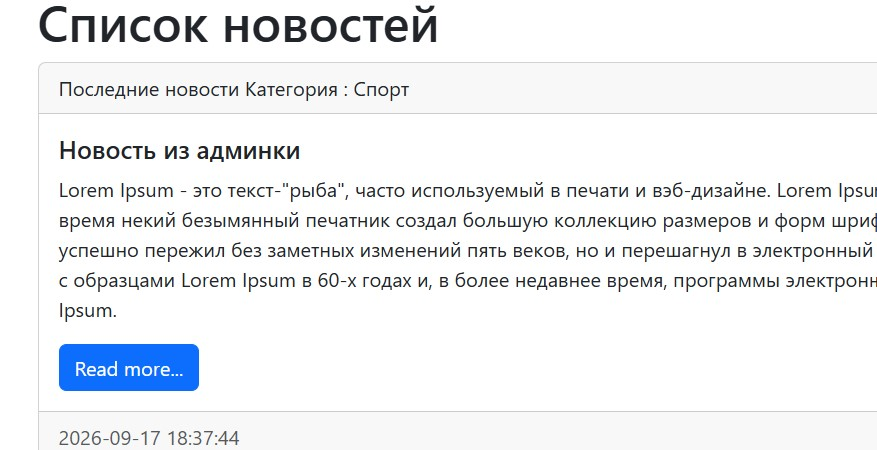

Рисунок 11 – Результат: текст «Последние новости» перед категорией

### 8. Использование тега cycle (чередование)
Тег cycle по очереди выводит свои аргументы. Применила его к классам Bootstrap для чередования цвета заголовков:

```html
<h5 class="card-title ">
    {{ item.title }}
</h5>
```
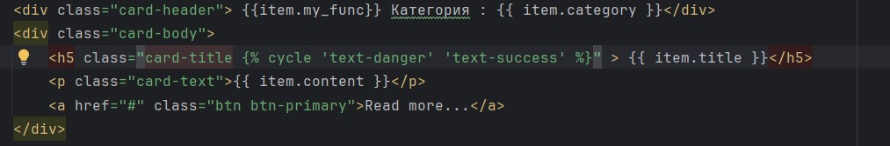

Рисунок 12 – Применение тега  к заголовку

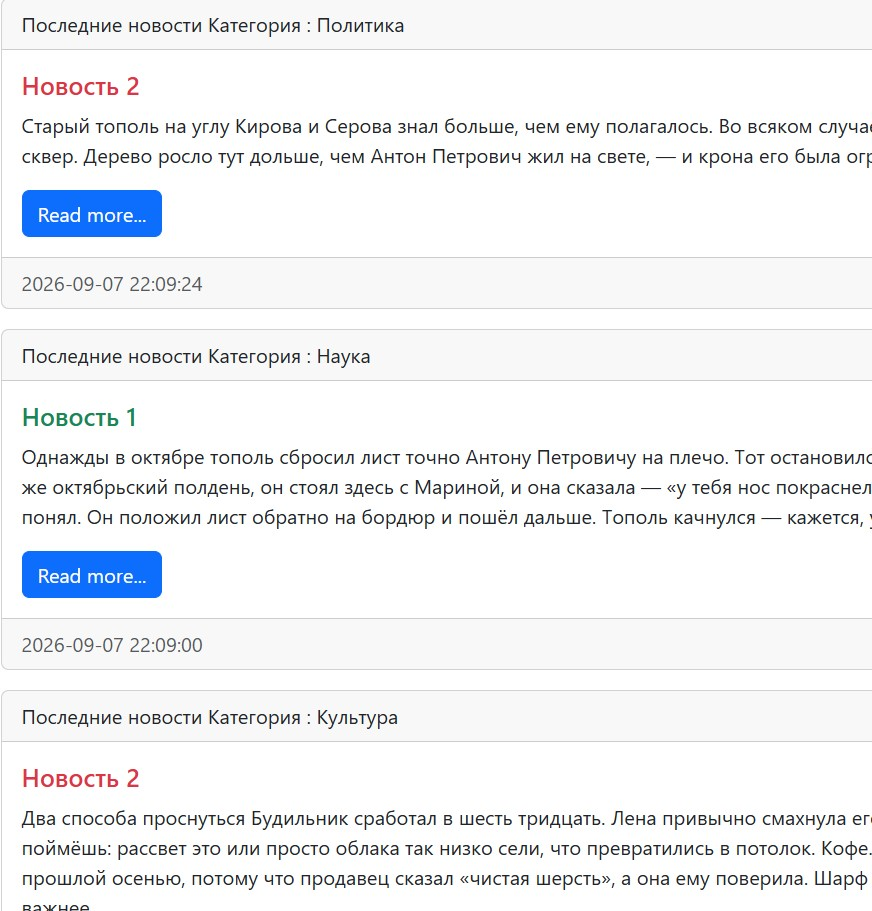

Рисунок 13 – Чередование цветов заголовков новостей

### 9. Использование forloop.counter (нумерация)
Внутри цикла использовала {{ forloop.counter }} для вывода порядкового номера (счётчик итераций, начинается с 1):

```html
<div class="card-header">
    {{ forloop.counter }}.
    {{ item.my_func }}
    Категория: {{ item.category }}
</div>
```
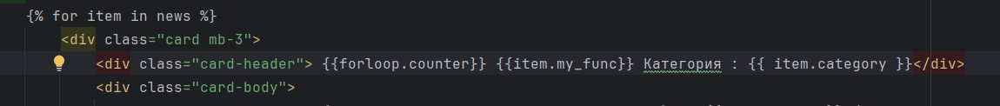

Рисунок 14 – Использование {{ forloop.counter }} для нумерации новостей

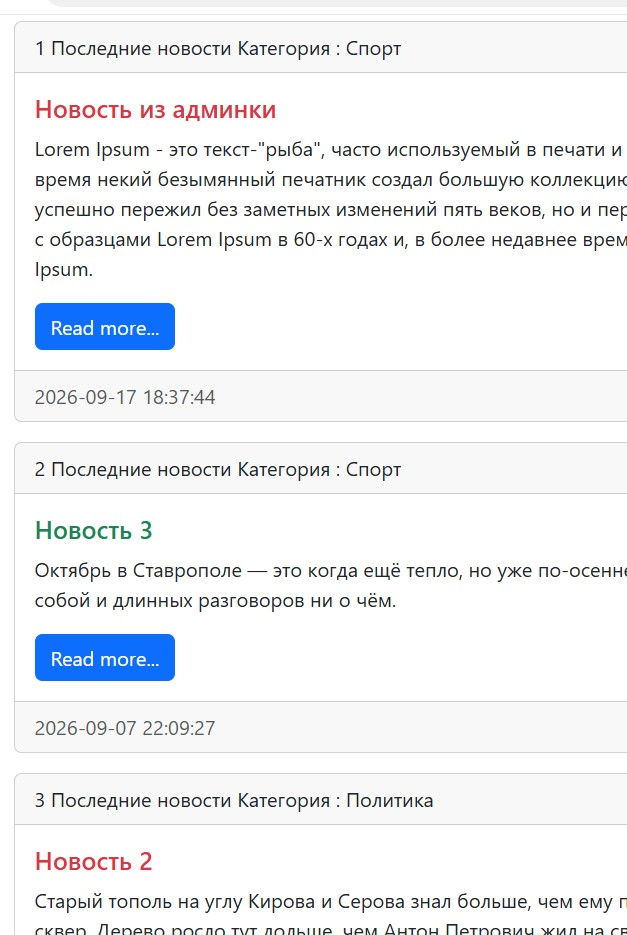

Рисунок 15 – Нумерация новостей в карточках

### 10. Использование тега now
Тег  выводит текущие дату и время в заданном формате. Добавила под заголовком:

```html
<h1>{{ title }}</h1>

```
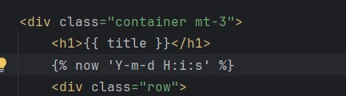

Рисунок 16 – Добавление тега  под заголовком

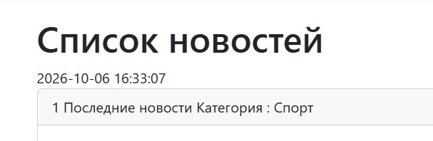
Рисунок 17 – Отображение текущей даты и времени на странице

### 11. Вывод изображений
Через админку открыла любую новость и в поле Фото выбрала файл изображения.

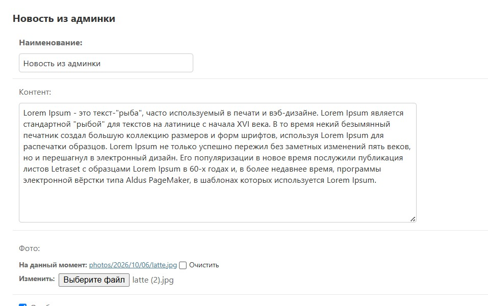

Рисунок 18 – Форма редактирования новости с загруженным фото

Внутри card-body добавила блок <div class="media"> с условием:

```html
<div class="card-body">
    <div class="media">
        
            
        
            
        
        <div class="media-body">
            <h5 class="card-title ">{{ item.title }}</h5>
            <p class="card-text">{{ item.content }}</p>
            <a href="#" class="btn btn-primary">Read more...</a>
        </div>
    </div>
</div>
```
Пояснение:  – если у новости есть фото, выводим его. {{ item.photo.url }} – URL загруженного изображения.  – если фото нет, показываем заглушку с сервиса picsum.photos.

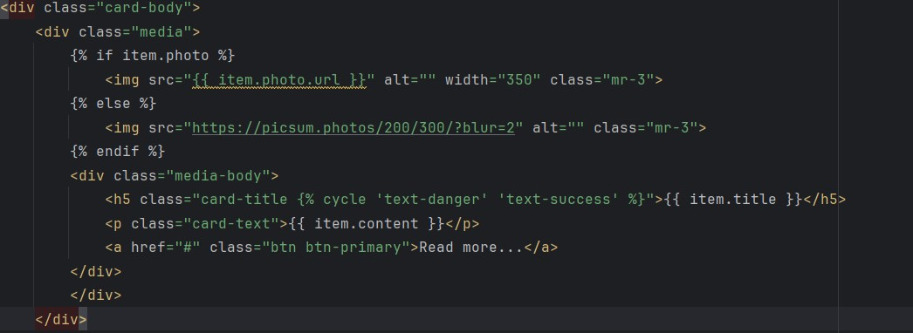

Рисунок 19 – Код вывода изображения с условием

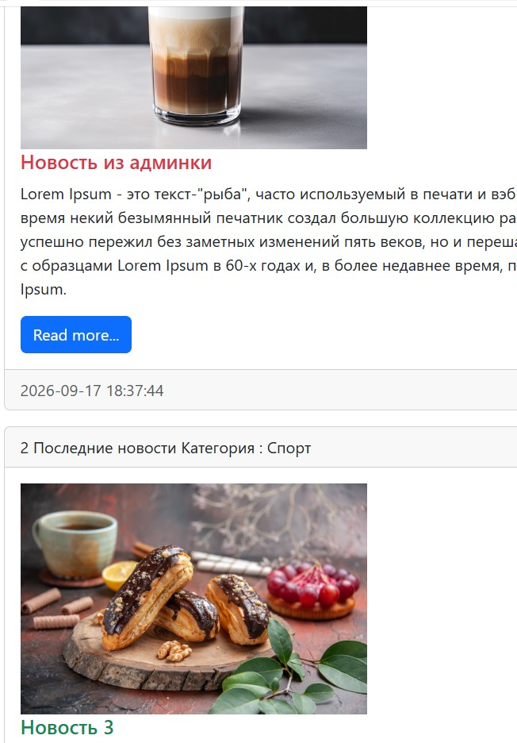

Рисунок 20 – Вывод изображений новостей на странице

## Вывод
Освоила подключение CSS-фреймворка Bootstrap через CDN, применила готовые компоненты (Navbar, Card) для оформления шаблона Django, изучила встроенные теги и фильтры шаблонного языка Django.
